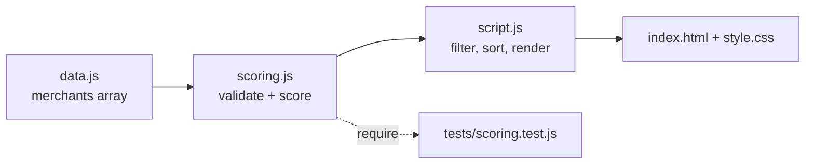

# Merchant Pulse — Churn Risk Dashboard

A small, dependency-free web dashboard that scores each merchant's **churn risk from 0 to 100**, groups merchants into Low / Medium / High risk buckets, explains *why* a merchant scored the way it did, and suggests a next action for the customer-success team.

> The dashboard runs on **static sample data** (`data.js`). It is a front-end demonstration of a rule-based scoring model; it has no backend, no live data source and no machine-learning model.

## Table of Contents

- [Overview](#overview)
- [Problem Statement](#problem-statement)
- [Key Features](#key-features)
- [Technology Stack](#technology-stack)
- [How the Score Works](#how-the-score-works)
- [Architecture](#architecture)
- [Project Structure](#project-structure)
- [Prerequisites](#prerequisites)
- [Running Locally](#running-locally)
- [Using Your Own Data](#using-your-own-data)
- [Testing](#testing)
- [Security Considerations](#security-considerations)
- [Known Limitations](#known-limitations)
- [Future Improvements](#future-improvements)
- [Contributing](#contributing)

## Overview

Open `index.html` and you get a summary of how many merchants fall in each risk bucket, plus a sortable, filterable table. Click a merchant row to see the per-factor score breakdown, the dominant risk signals and a recommended action.

## Problem Statement

Subscription businesses lose revenue when merchants quietly disengage. The warning signs (logins drying up, usage falling, failed payments, support friction, poor NPS) live in different places, so teams react late. This project combines those signals into a single transparent score so the merchants who need attention first are easy to find.

## Key Features

- **Transparent weighted score (0–100)** built from five signals; the breakdown is shown per merchant.
- **Risk buckets:** Low (≤ 33), Medium (≤ 66), High (> 66) with summary counts.
- **Filter by bucket** and **sort by score** (ascending or descending).
- **Expandable rows** (mouse or keyboard: Enter / Space) with score breakdown, risk focus and recommended action.
- **Action recommendations** driven by bucket and the dominant risk factors (billing, usage, support or re-engagement).
- **Input validation:** malformed merchant records are skipped with a console warning instead of showing a `NaN` score.
- **HTML-escaped rendering** of merchant fields.

## Technology Stack

| Area | Technology |
|------|------------|
| UI | HTML, CSS, vanilla JavaScript (no framework, no build step) |
| Tests | Node.js built-in test runner (`node:test`), no dependencies |
| CI | GitHub Actions |

## How the Score Works

Each factor contributes up to the maximum below; the maximums sum to 100 (`FACTOR_MAX` in `scoring.js`).

| Factor | Max points | Rule |
|--------|-----------:|------|
| Inactivity | 30 | 1 point per day since last login, capped at 30 |
| Usage decline | 25 | Only for negative 30-day usage trend: half the absolute % decline |
| Payment failures | 20 | 10 points per failed payment in the last 90 days |
| Support friction | 15 | Only above 3 tickets in 30 days: 3 points per extra ticket |
| NPS sentiment | 10 | `null` (no response) = 5; scores 0–6 = `(7 − NPS) × 10 / 7`; 7+ = 0 |

The total is rounded to one decimal. The **dominant factors** are all factors with points that are within 5 points of the highest one; they drive the recommendation text.

## Architecture



`scoring.js` is pure (no DOM access) and is loaded both in the browser (`window.MerchantScoring`) and in Node tests via `require`.

## Project Structure

```
.
├── index.html               # Page markup; loads data.js, scoring.js, script.js
├── style.css                # Styles
├── data.js                  # Static sample merchants (global `merchants`)
├── scoring.js               # Validation and scoring logic (browser + Node)
├── script.js                # UI: summary cards, table, filter, sort, expanded rows
├── tests/scoring.test.js    # Unit tests for scoring and the sample data
├── package.json             # `npm test` script
└── .github/workflows/ci.yml # Runs the tests on pushes to main and on pull requests
```

## Prerequisites

- A modern web browser.
- Node.js (tested with 22) only if you want to run the tests. There are no runtime dependencies.

## Running Locally

Either open `index.html` directly in a browser, or serve the folder:

```bash
git clone https://github.com/MageshS09/merchant-churn.git
cd merchant-churn
python3 -m http.server 8000      # then visit http://localhost:8000
```

## Using Your Own Data

Replace the array in `data.js`. Each merchant needs these fields:

| Field | Type | Notes |
|-------|------|-------|
| `id` | string | Non-empty, unique |
| `name` | string | Non-empty |
| `plan` | string | Used for the plan badge/style (`starter`, `growth`, `pro` in the sample) |
| `mrr` | number | Monthly recurring revenue in USD |
| `signupDate` | string | Display only (`YYYY-MM-DD`) |
| `lastLoginDaysAgo` | number | Days since last login |
| `supportTicketsLast30d` | number | |
| `npsScore` | number 0–10 or `null` | `null` = no response |
| `usageTrend30d` | number | Percent change in usage over 30 days |
| `paymentFailuresLast90d` | number | |

Records that fail validation are skipped and reported with `console.warn`.

## Testing

```bash
npm test        # runs: node --test
```

The suite covers each factor's rule and cap, bucket boundaries, dominant-factor selection, recommendations, input validation, and that every record in `data.js` is valid. GitHub Actions runs the same command on pull requests.

## Security Considerations

- Merchant text is HTML-escaped before it is inserted into the page, so names or other fields containing markup are displayed as text.
- The page has no backend, authentication or network requests. If you connect it to real merchant data, handle access control and data protection at that layer.

## Known Limitations

- Sample data only; there is no data loading, persistence or API.
- The weights and thresholds are hand-chosen heuristics and have not been validated against real churn outcomes.
- `signupDate` is displayed but not used in scoring, so very new merchants are scored like established ones.
- No browser/UI automated tests; the UI was checked manually against a DOM test harness only.
- No screenshots are included because none exist in the repository, and the repository declares no license.

## Future Improvements

- Load merchants from a file or API instead of `data.js`.
- Account for merchant tenure (new merchants) in the score.
- Calibrate weights against historical churn data.
- Add UI tests.

## Contributing

1. Fork the repository and create a branch (`git checkout -b feature/my-change`).
2. Make your change and add or update tests in `tests/`.
3. Run `npm test`.
4. Open a pull request describing the change and why it is needed.
